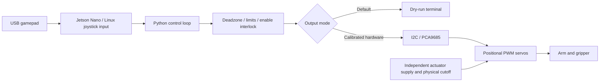

# Jetson Nano Powered Joystick Controlled Robotic Arm

A Python-based teleoperation project for a multi-joint robotic arm mounted on a mecanum-wheel mobile platform. A USB gamepad provides intuitive joint-level control, while the Jetson Nano processes joystick events and issues bounded position commands to a servo controller.


*Enhanced showcase image: the terminal is a visual mock-up, not a captured execution log. See the [original prototype photo](assets/original-prototype.png).*

## Project status

The photographed prototype includes a gripper, articulated arm, wheeled chassis, display and USB gamepad. This repository supplies a reference implementation, not firmware extracted from the prototype. The exact actuator models, controller board, wiring and gamepad mapping have not been verified. The included hardware backend assumes a dedicated PCA9685 board and five conventional positional PWM servos. If the actual arm uses serial bus servos or a proprietary controller, replace `arm/output.py` with the correct protocol adapter. Wheel propulsion is not implemented. No AI model, autonomous navigation or object recognition is included.

## Features

- Real-time Linux USB joystick event reading with configurable axes and button mapping.
- Joint-space control for base rotation, shoulder, elbow, wrist and gripper.
- Adjustable deadzone, direction, joint limits and maximum command rates.
- Hold-to-run button, neutral-start interlock and latched software stop.
- Optional user-calibrated home, pick and place poses (disabled by default).
- Terminal status and joint command values; dry-run and synthetic demo modes.
- Hardware output explicitly gated behind local calibration and `--hardware`.
- Unit tests and a GitHub Actions workflow.

## System architecture



## Hardware and software

| Component | Purpose / status |
|---|---|
| NVIDIA Jetson Nano | Target embedded Linux computer |
| USB gamepad | Manual teleoperation input |
| Robotic arm and gripper | Prototype mechanism |
| Mecanum-wheel chassis | Mechanical platform; wheel control excluded |
| PCA9685 servo driver | Assumed reference backend; confirm actual board |
| Five positional PWM servos | Assumed joint configuration; confirm models and count |
| External regulated servo supply | Size voltage/current to actual actuator specifications |
| Monitor / touchscreen | Optional terminal display |
| Ubuntu / JetPack 4.x, Python 3.6+ | Target software environment |
| Linux joydev, SMBus/I2C | Input and optional hardware interface |

JetPack 4.6.6 is the final release in the JetPack 4 series. It is a legacy platform; avoid exposing it directly to the internet and follow available maintenance guidance.

## Quick start (no hardware output)

Download or clone this repository, open a terminal in its root folder, and run:

```bash
python3 main.py --demo
python3 -m unittest discover -s tests -v
```

For a connected gamepad on Linux:

```bash
ls /dev/input/js*
python3 joystick_test.py
cp config.example.json config.local.json
python3 main.py --config config.local.json
```

Use `joystick_test.py` to identify each physical control. Edit the local JSON mapping before use. No motors are driven by these commands. If the joystick device is missing, check Linux driver support (`joydev`) and device permissions. Do not run the entire controller as root simply to bypass permissions.

## Example control map

The physical labels vary across USB controllers. These are example Linux indices, not verified mappings for the photographed gamepad.

| Physical control | Action | Default index |
|---|---|---|
| Left stick horizontal | Base rotation | Axis 0 |
| Left stick vertical | Shoulder | Axis 1 |
| D-pad vertical | Elbow | Axis 5 |
| Right stick horizontal | Wrist | Axis 2 |
| Right stick vertical | Gripper | Axis 3 |
| Button 1 | Home pose (optional) | Button 0 |
| Button 2 | Pick pose (optional) | Button 1 |
| Button 3 | Place pose (optional) | Button 2 |
| Button 4 | Latch software stop | Button 3 |
| Shoulder button | Hold to enable motion | Button 4 |

For a safe software start, release the enable button, center all mapped axes and then press and hold enable. Releasing it stops new commands; pressing the stop button ends the application. Presets require individually calibrated positions and clearance checks. They are poses, not automatic pick-and-place sequences or collision-aware trajectories.

## Connecting actual hardware

**Do not connect the supplied example configuration to powered actuators without verifying the board and completing [commissioning](docs/COMMISSIONING.md).** Support the arm, secure the mobile base and provide an independent physical power cutoff. A software stop is not a safety-rated emergency stop. The PCA9685 can retain PWM outputs after program exit, a communication error or joystick disconnection; the arm may keep moving toward the last commanded position or continue holding torque. Cutting power can also cause the arm or load to fall. No encoder feedback or independent watchdog is implemented.

Only if the confirmed driver is a PCA9685 for conventional positional PWM servos:

```bash
sudo apt update
sudo apt install python3-smbus i2c-tools joystick
# Identify available I2C adapters (does not scan devices):
i2cdetect -l
```

Follow the commissioning guide to verify the I2C bus/address, PWM calibration and servo supply. Copy the example configuration, set the actual joints and tested limits, and set `hardware_calibrated` to `true` only after completing those checks. Then explicitly enable hardware mode:

```bash
python3 main.py --config config.local.json --hardware
```

The first successful enable sends the configured initial pose; it is not a measured pose or a ramp from the current physical position. Ensure the mechanism is supported and aligned before enabling. Terminal angles are commanded targets, not measured positions.

## Example terminal output

Run `python3 main.py --demo` to see a repeatable software-only demonstration. The demo initializes example joint positions, changes the base target within its configured limit, and releases the enable button.

```text
Jetson Nano Powered Joystick Controlled Robotic Arm
[MODE] DRY RUN (no motor outputs)
[DRY RUN] Initial pose: {...}
[DEMO] MANUAL - ENABLED {...}
[DEMO] HOLD - PRESS DEADMAN WITH STICKS NEUTRAL
```

## Applications

Educational robotics, manual object manipulation, embedded Linux programming, servo calibration and human–robot interface prototyping. These are intended use cases, not validated industrial capabilities.

## Repository layout

```text
main.py                  Entry point and terminal status
joystick_test.py         Gamepad mapping utility
config.example.json      Example input and actuator settings
arm/joystick.py          Linux input event reader
arm/controller.py        Joint command and enable logic
arm/output.py            Dry-run and PCA9685 output backends
tests/                   Software unit tests
docs/COMMISSIONING.md    Hardware verification and wiring guide
docs/GITHUB_PUBLISH.md   Repository metadata and publishing steps
assets/                  Original and enhanced project photographs
.github/workflows/       Continuous integration checks
```

## Future improvements

- Implement the verified actuator protocol and wheel motor driver.
- Add feedback-based joint positioning, independent watchdog and physical safety interlocks.
- Add collision-aware motion planning and inverse kinematics.
- Explore camera-assisted manipulation and object detection on Jetson Nano.

## References

- [NVIDIA JetPack 4.6.6](https://developer.nvidia.com/jetpack-sdk-466)
- [NVIDIA Jetson Linux R32.7.6](https://developer.nvidia.com/embedded/linux-tegra-r3276)
- [Linux joystick API](https://github.com/torvalds/linux/blob/master/Documentation/input/joydev/joystick-api.rst)
- [Adafruit PCA9685 pinouts and power guidance](https://learn.adafruit.com/16-channel-pwm-servo-driver/pinouts)

## License

No public-use license has been selected by the project owner. Add a license before inviting reuse or redistribution; GitHub visibility alone does not grant an open-source license.
